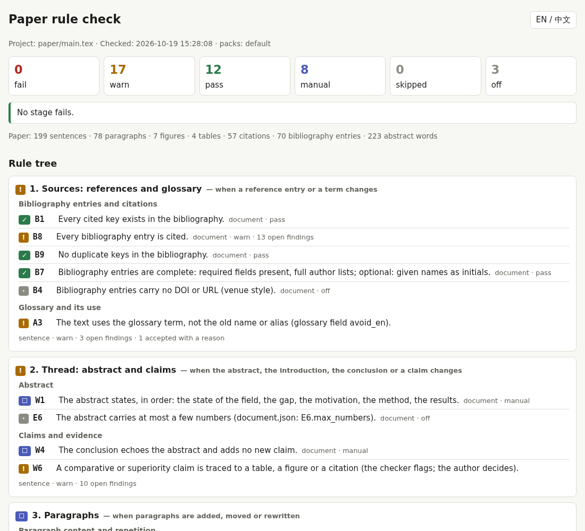

# paperrules

**English** · [简体中文](README.zh-CN.md)

Rule-based writing checks for LaTeX papers. You write down what good writing means *for your paper* as rules; `paperrules` reads the LaTeX source, applies the rules sentence by sentence, paragraph by paragraph and document-wide, and gives you an offline report arranged along a **rule tree**, so you know which layer of the paper to revise first.

<p align="center"></p>

* **Rules are data, not code.** Every rule is an entry in a JSON register with a bilingual statement, a reason, a stage in the tree, and test sentences. Add a pattern rule in ten lines of JSON; the tests tell you at once whether it does what you meant.
* **A rule tree, not a flat list.** Sources → thread → paragraphs → sentences → format → the rule system itself. A failing stage makes the stages below it provisional: *revise at the highest failing stage* (rewriting a sentence is wasted if its paragraph will change).
* **Findings are questions, not verdicts.** A flagged sentence can stay, with a written reason (`exceptions.json`); the report keeps accepted exceptions visible.
* **Offline, bilingual report.** One HTML file (no server, CDN or font download), English / 中文 switch, readable on a phone; plus JSON and plain text.

> **Status: v0.1.** The default pack encodes one author's English writing preferences (active voice, one main action per sentence, strengths first, no filler, …). They are opinions. Switch off what you disagree with, and see [what the checker does not do](#what-the-checker-does-not-do).

## Quick start

```bash
git clone <this repository> && cd paperrules
pip install -e .                                  # installs spaCy
pip install -e ".[figures]"                       # optional: PyMuPDF for the figure-file rules G1–G4
python -m spacy download en_core_web_sm           # the parser model used by the structure rules

python -m paperrules test examples/aptp-cvpr2026  # the rules pass their own tests (R0, R1)
python -m paperrules check examples/aptp-cvpr2026 # check the example paper (a few seconds)
# open examples/aptp-cvpr2026/out/report.html
```

The example is a published CVPR 2026 infrared–visible image-fusion paper that is released under CC BY 4.0 (see [`examples/aptp-cvpr2026/README.md`](examples/aptp-cvpr2026/README.md)). Its reference output is in `examples/aptp-cvpr2026/expected/`.

## Check your own paper

```bash
python -m paperrules init my-paper --main main.tex --bib refs.bib   # writes paperrules.json and starter files
# copy or point to your LaTeX sources inside my-paper/ (or use "main_tex": "../paper/main.tex")
python -m paperrules check my-paper               # text summary + out/report.html, report.json, report.txt
python -m paperrules check my-paper -v            # every open finding in the terminal
python -m paperrules check my-paper --only W10,W14
python -m paperrules check my-paper --strict      # exit status 1 on warnings too (CI)
```

Read the report top-down. For each finding you can:

1. **rewrite the sentence** (the usual case);
2. **keep it, with a reason**: `python -m paperrules accept W12 "We evaluate …" --reason "the authors are the actor" --project my-paper`; the sentence passes next time, the reason stays in the report;
3. **change the rule**, if the rule is wrong for your paper: see [Customize the rules](#customize-the-rules).

`python -m paperrules sentences my-paper --grep "regex"` prints the sentences exactly as the checker reads them: useful when a finding looks strange.

### Exit status

`0`: no rule fails (warnings allowed unless `--strict`). `1`: a rule with severity `error` has an open finding, or `--strict` and a warning is open. Style rules are `warn` by default; reference and test rules (`B1`, `B2`, `B9`, `R0`, `R1`) are `error`.

## The rule tree

| Stage | Reads | Examples |
|---|---|---|
| **S1 Sources** | bibliography, glossary | cited keys exist, entries complete, glossary terms used (`B1`, `B7`, `B8`, `A3`) |
| **S2 Thread** | abstract, claims | superiority claims need support (`W6`); abstract and conclusion (manual `W1`, `W4`) |
| **S3 Paragraphs** | paragraph content | no repeated sentence (`F2`); manual checks (`W2`, `O2`) |
| **S4 Sentences** | structure, voice, tone, wording | one main action (`W14`), active voice (`W10`), "we" (`W12`), filler (`W7`), consequence connectives (`W13`), head nouns (`A6`) |
| **S5 Format** | venue limits, floats, references | abstract limits (`J1`), figure/table/algorithm order (`T1`, `T2`), proposed method last in tables (`T10`, opt-in), unknown labels (`B2`); figure files measured at their printed size — embedded fonts, body font family, text ≥ 8 pt, line weights (`G1`–`G4`), and a figure-design checklist (`G5`–`G9`: one visual language and colour roles, line grammar, no formulas or small grey text in diagrams, boxes sized to content, real or schematic images from registered files) |
| **S6 Rule system** | the register itself | every rule is in the tree (`R0`); every rule passes its own tests (`R1`) |

All 49 rules, bilingual: [`docs/rules.md`](docs/rules.md) (`python -m paperrules rules tree` prints the tree, `rules show W14` one rule). Rules have a **method**: `auto` (the checker decides), `partial` (the checker flags, you decide) and `manual` (a person checks; these appear as a checklist at the end of the report).

## Customize the rules

Everything is merged from the pack in `paperrules/packs/default/` and a local file next to your paper, `rules.local.json`. The full guide, with the schema of every file, is [`docs/customizing-rules.md`](docs/customizing-rules.md). The common moves:

```jsonc
// my-paper/rules.local.json
{
  "disable": ["W12"],                         // switch a rule off
  "enable":  ["J1", "T5"],                    // switch on a venue rule the pack leaves off
  "severity": {"W6": "error"},                // warn → error
  "document": {"J1": {"min": 150, "max": 250}},   // a number of a rule
  "tone": {"W8": {"patterns_add": ["\\bobviously\\b"]}},   // extend a rule's patterns (_add / _remove)
  "rules_add": [{                             // a new rule, with its own tests
    "id": "U1", "stage": "S4", "node": "wording", "scope": "sentence", "method": "auto", "severity": "warn",
    "statement": {"en": "Write “vs.” (not “v.s.”).", "zh": "写“vs.”，不写“v.s.”。"},
    "why": {"en": "One spelling across the paper.", "zh": "全文同一种写法。"},
    "check": {"type": "pattern", "pattern": ["\\bv\\.s\\.?"], "message": "write vs.:"},
    "tests": {"flag": ["It is compared v.s. the baseline."], "pass": ["It is compared vs. the baseline."]}
  }]
}
```

Then run `python -m paperrules test my-paper` (R1 runs every test sentence of every rule, including yours) and `python -m paperrules check my-paper --only U1`. A glossary (`glossary.json`) switches on the term rules: `A3` flags names you retired (`avoid_en`), `A6` flags subjects and objects whose head noun is not a glossary noun, `A7` flags phrases that name a concept with another noun.

## What the checker does not do

* **It does not judge the science or the argument.** It reads sentences and structure. A clean report is not a good paper, and the findings on a good paper are not criticism of it.
* **It reads the LaTeX source, not the PDF.** Float order is the order in the source; page layout, overfull boxes, fonts and figure readability are not checked (rules about them are `manual`).
* **English only.** The sentence rules and the spaCy model are English. The report is bilingual; the paper is not.
* **Parser mistakes happen.** `W14`–`W16` and `A6` use a small spaCy model and sometimes misread a sentence. Accept the finding with a reason.
* **Not included in this release:** a number-to-source evidence registry (every number in the text traced to a result file), a storyline/flow checker across sections, Chinese–English sentence alignment, and PDF layout checks. They exist in the research workspace this project grew out of and are candidates for later releases.

## Layout

```
paperrules/             package (reader, rules, runner, report, CLI) and packs/default/*.json (the rules)
examples/aptp-cvpr2026/ a CC BY 4.0 paper, a glossary, local rules, exceptions, expected/ output
docs/                   customizing-rules (EN, 中文), rules.md, screenshots
tests/                  python -m unittest discover -s tests   (29 tests)
```

## License

Code: MIT (see [`LICENSE`](LICENSE)). The example paper keeps its own license, CC BY 4.0 (see [`NOTICE`](NOTICE)).
